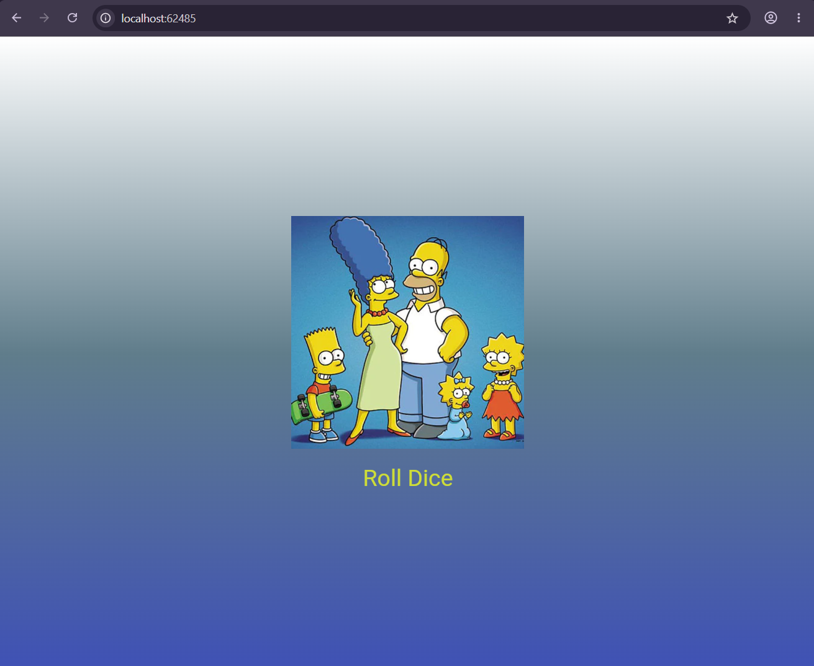

# Лабораторная работа №4-5. Flutter: структура UI и компонентный подход
### Информация об авторе
Киренкина Вероника ИСП-241 16.11.2026

### Что изучила

1. Создание собственных виджетов-классов
2. Научилась разбивать код на файлы
3. Научилась передавать данные через параметры
4. Отличия `StatelessWidget` и `StatefulWidget`

### Скриншот финального приложения

### Ссылка на репозиторий
[Ссылка на репозиторий](https://github.com/oxsjkw/Flutter_Widgets)

### Инструкция по запуску
1. Клонировать репозиторий
2. Перейти в папку проекта
3. Выполнить `flutter pub get`
4. Запустить командой `flutter run -d chrome`

### Ответь на вопросы:
1. Зачем выносить виджеты в отдельные файлы? Что изменится если держать всё в
main.dart?
**Ответ:** Будет неудобно. С выносом виджетов в отдельные файлы код чище и читаемым, иначе будет 550 строк
2. Что такое BuildContext? Почему метод build() принимает его как параметр?
**Ответ:** BuildContext содержит информацию о положении виджета в дереве. build() принимает его, потому что виджет хочет знать, где он находится, чтобы хорошо нарисоваться
3. Чем StatelessWidget отличается от StatefulWidget? Приведите пример когда
нужен каждый из них.
**Ответ:** У StatelessWidget не состояния, он не меняется. У StatefulWidget есть состояние, он может поменяться во время выполнения. Пример: приложение в лабе, для фона и тд нужен StatelessWidget, а для смены картинки StatefulWidget
4. Почему Random() создаётся на уровне файла, а не внутри rollDice()?
**Ответ:** Чтобы он не создавался заново каждый раз, это менее эффективно
